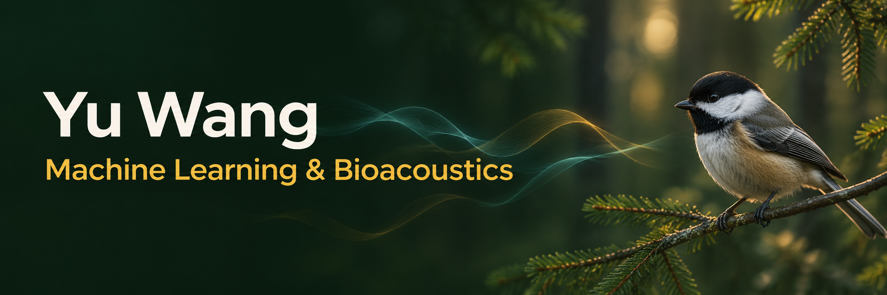

# Yu Wang

**Machine Learning · Computing Science PhD candidate at the University of Alberta**

[Try the Demo](https://fionawyu.github.io/birdsong-demo/) · [Personal Website](https://fionawyu.github.io/) · [Research Notes](https://fionawyu.github.io/#research-notes)

I build machine learning methods that turn bird recordings into interpretable note sequences for comparing vocalizations across species, dialects, and individuals.

## Selected work

**[BirdTokenSequences](https://github.com/fionawyu/birdtokensequences)** — Research code for comparing and classifying bird vocalizations with symbolic note sequences. The pipeline fits formulas to frequency contours, maps them to shape tokens, and compares sequences with edit distance.

**Research question.** When does note order add information beyond pitch, duration, and note counts? Comparing an ordered sequence with a shuffle of the same notes gives us one way to test it.

## Recent update

- **November 2026** · [BirdTokenSequences research code](https://github.com/fionawyu/birdtokensequences) is available on GitHub.

## Research notes and reading

In my [research notes](https://fionawyu.github.io/#research-notes), I connect work on audio embeddings, animal communication, and audio tokenization to experiments in birdsong.

[Audio research on arXiv](https://arxiv.org/list/cs.SD/recent) · [Machine learning preprints on arXiv](https://arxiv.org/list/cs.LG/recent) · [GitHub Changelog](https://github.blog/changelog/)

## Collaborate

I'm open to research collaborations in bioacoustics, audio machine learning, and ecological monitoring, as well as 2027 postdoctoral and applied research opportunities.

[Contact via my personal website](https://fionawyu.github.io/)

Outside research, I enjoy reading, coding, and keeping a journal.
